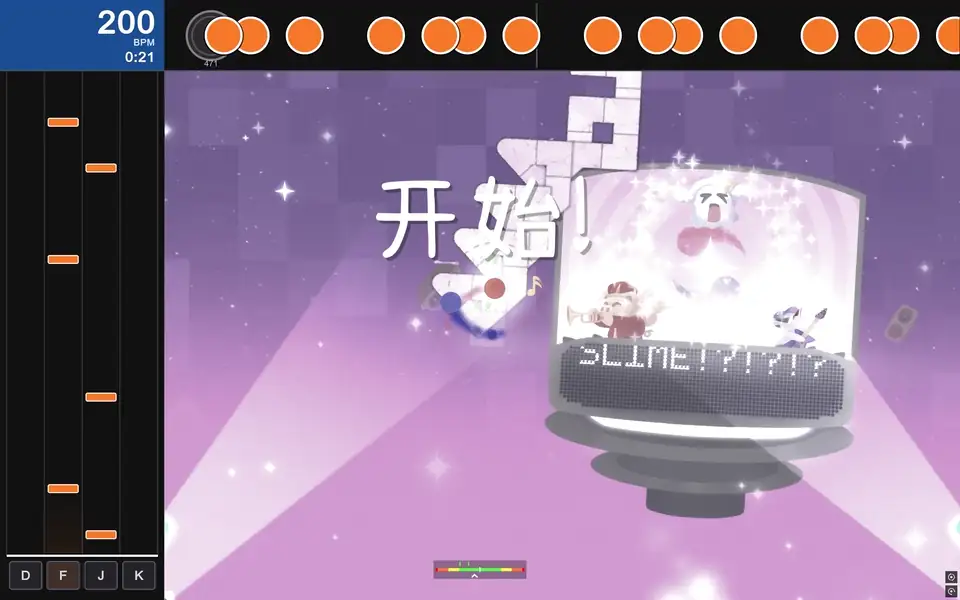
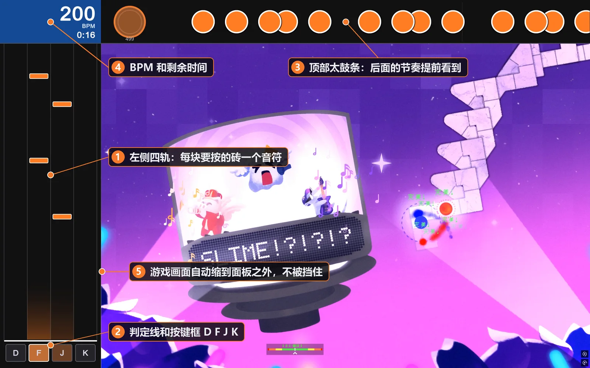
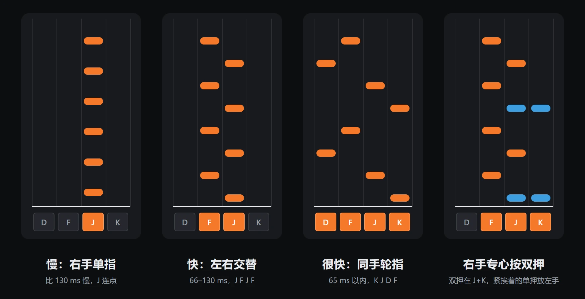
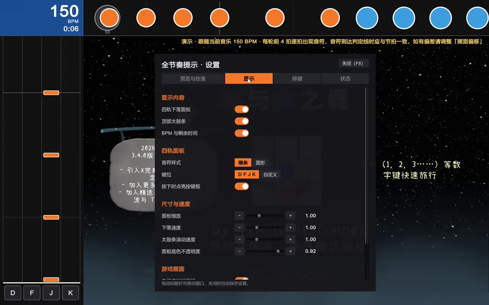
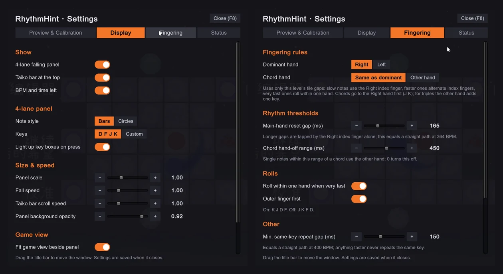

# RhythmHint

**A rhythm-game style hint panel for A Dance of Fire and Ice**

[简体中文](README.md) | [繁體中文](README.zh-Hant.md) | English | [한국어](README.ko.md) | [日本語](README.ja.md)

 

In A Dance of Fire and Ice any key counts, but once the rhythm gets messy, watching the planets spin just isn't enough to read what's coming.

So I made this mod: it turns every level's tiles into falling notes, so you can see what to press next, just like in a rhythm game. It only shows hints and never touches judgment, so your results work exactly as before.

## What it looks like

- **Four lanes on the left**: one note for every tile you need to press. Orange for single notes, blue for doubles, purple for triples and quads, and holds get a tail. You can switch the bars to round notes like the taiko bar in the settings
- **Key boxes at the bottom**: light up when you press D F J K
- **Taiko bar at the top**: a long stretch of the upcoming rhythm at a glance
- **Top left**: current BPM and time left
- **Fit game view beside panel**: the game view and its UI text (combo, judgments, pause menu) shrink into the space next to the panel, so nothing is covered (you can turn this off in the settings)

The panel slides in when a level starts and out when it ends. It also hides when you pause with Esc, so it never covers the pause menu, and it freezes when you die and continues when you restart. Works with official levels, custom levels, and editor playtests and autoplay.

## How keys are assigned

No external charts are read. Each level only looks at the gaps between its own tiles and follows the habits of most ADOFAI players:

- Slow (more than 165 ms apart): **tap with the right index finger, J**
- A bit faster: **J F, alternating index fingers**
- Very fast (within 82 ms): two fingers of one hand take turns, **K J D F**
- After a pause it always starts again from the **right hand**
- Doubles go to the **right hand, J K**, when possible; single notes right next to a double go to the **left hand**, so the right hand can focus on the double. A double is never split across hands
- The same hand never goes index finger first, then outer finger (F→D, J→K); rolls always start with the outer finger
- The same key is never pressed twice within 150 ms

Left-handed players can set the dominant hand to left in the settings, which mirrors the whole layout: left F as the main key, doubles on D F, and rolls become D F K J.

If you like single notes on one hand and chords on the other, set "Chord hand" to "Other hand": for example, J on the right hand stays the main key, doubles go to D F on the left, and single notes next to a double move to the right hand.

Triples and quads are recognized too (purple): for a triple, the chord hand presses two keys and the other hand's index finger adds one; a quad uses all four keys.
Which tiles count as pressed together depends on how far the path turns between them: tiles the creator drew bunched together (a tiny turn angle) form a chord, while fast streams with normal angles and just a very high BPM are no longer mistaken for doubles.

If something doesn't feel right, the thresholds and rolls can all be adjusted in the settings.

## Settings

Press **F8** in game.

Outside a level, opening the settings plays a demo next to the window that follows the menu music, so you can see every change right away. If notes and music don't line up, adjust "Visual offset" here until notes land right on the beat.

The window can be dragged and saves automatically when closed, and clicking around in it never triggers the game.

The interface language can be changed on the Status page: 简体中文, 繁體中文, English, 한국어 and 日本語. By default it follows the game's language, and languages without a translation show English.

## Installation

1. Install [Unity Mod Manager](https://www.nexusmods.com/site/mods/21) (0.27 or later, using the DoorstopProxy method)
2. Download `RhythmHint-<version>.zip` from [Releases](https://github.com/xiaoming6680/ADOFAI-RhythmHint/releases), then click **Install Mod** on the Mods tab of the UMM installer and choose it (or just drag the zip into the window)
   - You can also unzip it by hand and put the `RhythmHint` folder into `<game folder>\Mods\`
3. Start the game and press `Ctrl+F10` to check that it is enabled

To update later, just install the new `RhythmHint-<version>.zip`; there's no need to reinstall UMM.

To build it yourself, see the [development notes](docs/开发说明.md) (in Chinese).

## Troubleshooting

- **No hints showing**: F8 → the Status page tells you why; the UMM log `Managed\UnityModManager\Log.txt` has it too
- **Not using D F J K**: on the Display page, click "Custom" and pick your own four keys on the on-screen keyboard (Shift, Space and arrow keys work too)
- **Does it affect my results?** No, judgment is not touched at all

## Credits

- Inspired by, and technically based on, the video [《【冰与火之舞·全节奏提示】CE-TX Dramatic Entrance!》](https://www.bilibili.com/video/BV17Agv6sEug) by Bilibili creator **Winkle雪线**. Thank you!
- Built on [Unity Mod Manager](https://www.nexusmods.com/site/mods/21)
- Screenshots are from the official level CI-X "REINCARNA✝ION!! ~Idol Graduation~" (7th Beat Games), music *REINCARNA✝ION!! Idol Graduation* by Turbo ft. Moon Jelly

## License

The code is open source under [MIT](LICENSE). The level visuals and music in the screenshots belong to their original creators.
