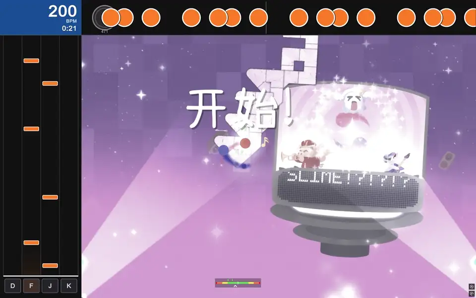
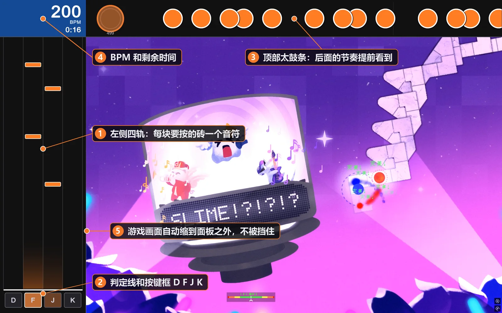
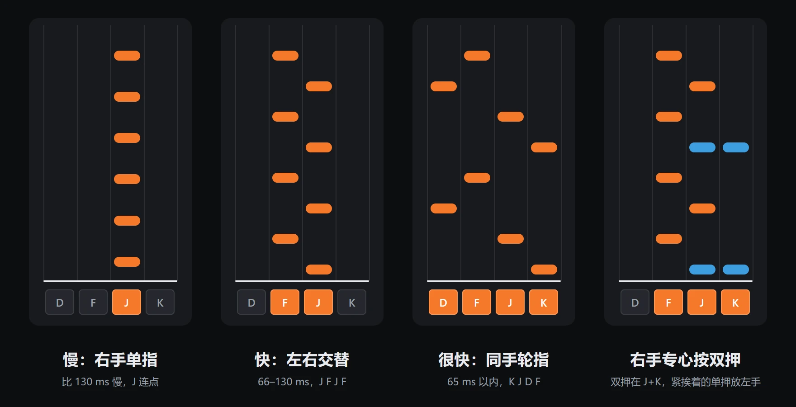
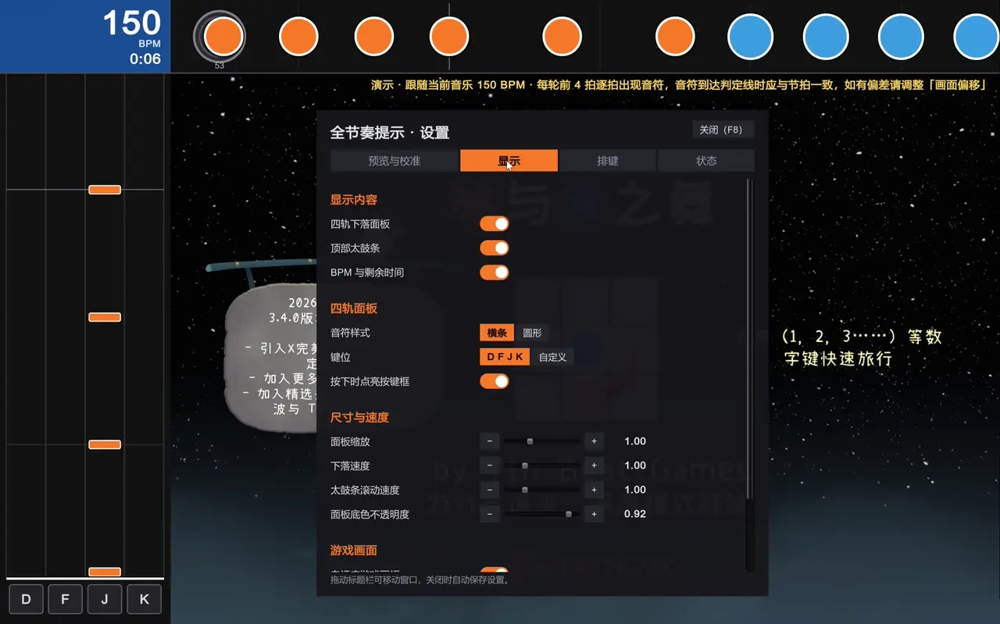
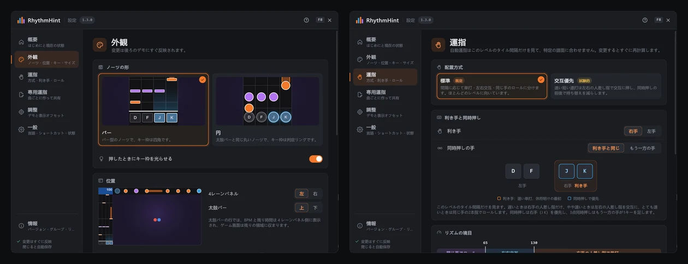

# RhythmHint

**A Dance of Fire and Ice に音ゲー風のガイドパネルを追加する Mod**

[简体中文](README.md) | [繁體中文](README.zh-Hant.md) | [English](README.en.md) | [한국어](README.ko.md) | 日本語

 

A Dance of Fire and Ice はどのキーを押してもいいゲームですが、リズムが崩れてくると、惑星の回転を見ているだけでは次の拍が読めなくなります。

そこでこの Mod を作りました。レベルのタイルを落ちてくるノーツに変えて、音ゲーのように次に押すものを先に見られるようにします。表示するだけで判定には一切触れないので、記録は元のままです。

## 画面の見かた

- **左の 4 レーン**：押すタイルごとにノーツが 1 つ出ます。オレンジは単押し、青は 2 点同時押し、紫は 3 点・4 点同時押しで、ホールドには尾が付きます。設定でバーを太鼓バーと同じ丸いノーツに変えられます
- **下のキー枠**：D F J K を押すと光ります
- **上の太鼓バー**：この先のリズムを長めに見渡せます
- **左上**：現在の BPM と残り時間
- **ゲーム画面を自動調整**：ゲーム画面と UI の文字（コンボ、判定、ポーズメニュー）がパネルの外側に縮まるので隠れません（設定でオフにできます）

レベルが始まるとパネルが入ってきて、終わると出ていきます。Esc でポーズしたときも格納されてポーズメニューを隠さず、ミスすると画面が止まり、リトライするとそのまま続きます。公式レベル、カスタムレベル、エディターのテストプレイとオートプレイに対応しています。

## キーの割り振り方

外部の譜面は読みません。各レベルは自分のタイル同士の間隔だけを見て、多くの ADOFAI プレイヤーの癖に合わせて割り振ります。

- 遅いとき（間隔が 165 ms より長い）：**右手の人差し指 J で連打**
- 少し速いとき：**J F、左右の人差し指で交互に**
- とても速いとき（82 ms 以内）：片手の 2 本指で交互に、**K J D F**
- 休みのあとは必ず**右手**から
- 2 点同時押しはなるべく**右手の J K** に置き、そのすぐ隣の単押しは**左手**に回して、右手を同時押しに集中させます。左右の手に 1 つずつ分かれた同時押しにはなりません
- 同じ手で人差し指のあとに外側の指（F→D、J→K）が来ることはなく、ロールは必ず外側の指から押します
- 同じキーを 150 ms 以内に 2 回押させることはありません

左利きの方は設定で利き手を左手にすると、割り振り全体が左右反転します。左手の F が中心になり、2 点同時押しは D F、ロールは D F K J になります。

単押しは片手、同時押しはもう片方の手で押したい場合は、「同時押しの手」を「もう一方の手」にしてください。たとえば右手の J を中心にしたまま、2 点同時押しを左手の D F に置き、同時押しのすぐ隣の単押しは右手に移します。

3 点・4 点同時押しも認識します（紫）。3 点同時押しは同時押しの手が 2 キー、もう一方の手の人差し指が 1 キーを押し、4 点同時押しは 4 キーすべてを押します。
どのタイルを同時に押すかは、道がどれだけ曲がるかで判断します。作者がひとかたまりに描いたタイル（回転角がとても小さいもの）は同時押しになり、角度は普通で BPM だけがとても高い速い連打は、もう 2 点同時押しと間違えられません。

しっくりこなければ、境目の間隔やロールは設定ですべて調整できます。

## 設定

ゲーム中に **F8** を押します。

レベルの外で設定を開くと、メニュー音楽に合わせたデモが横で再生されるので、何を変えてもすぐに確認できます。ノーツと音楽が合わないときは、ここで「表示オフセット」をノーツがちょうど拍に乗るまで調整してください。

ウィンドウはドラッグで動かせて、閉じると自動で保存されます。ウィンドウ内をクリックしてもゲームの入力にはなりません。

表示言語は状態ページで切り替えられます：简体中文、繁體中文、English、한국어、日本語。初期設定ではゲームの言語に合わせ、翻訳のない言語は英語で表示します。

## インストール

1. [Unity Mod Manager](https://www.nexusmods.com/site/mods/21) をインストールします（0.27 以上、DoorstopProxy 方式）
2. [Releases](https://github.com/xiaoming6680/ADOFAI-RhythmHint/releases) から `RhythmHint-<バージョン>.zip` をダウンロードし、UMM インストーラーの Mods タブで **Install Mod** を押して選びます（zip をウィンドウにドラッグしても OK）
   - 手動で解凍して、中の `RhythmHint` フォルダーを `ゲームフォルダー\Mods\` に入れても構いません
3. ゲームで `Ctrl+F10` を押し、有効になっているか確認します

今後のアップデートは新しい `RhythmHint-<バージョン>.zip` を入れるだけで、UMM の入れ直しは不要です。

自分でビルドする場合は[開発メモ](docs/开发说明.md)（中国語）を参照してください。

## 困ったときは

- **ガイドが出ない**：F8 → 状態ページに理由が出ます。UMM のログ `Managed\UnityModManager\Log.txt` にも残ります
- **D F J K を使わない**：表示ページで「カスタム」を押し、画面キーボードで自分の 4 キーを選んでください（Shift、スペース、矢印キーも使えます）
- **記録に影響はある？** ありません。判定にはまったく触れていません

## 謝辞

- アイデアと技術は Bilibili のクリエイター **Winkle雪线** さんの動画 [《【冰与火之舞·全节奏提示】CE-TX Dramatic Entrance!》](https://www.bilibili.com/video/BV17Agv6sEug) を参考にしました。ありがとうございます！
- [Unity Mod Manager](https://www.nexusmods.com/site/mods/21) を使用
- スクリーンショットは公式レベル CI-X「REINCARNA✝ION!! ～アイドル卒業～」（7th Beat Games）、楽曲 *REINCARNA✝ION!! Idol Graduation* by Turbo ft. Moon Jelly

## ライセンス

コードは [MIT](LICENSE) で公開しています。スクリーンショットに写っているレベル画面と音楽の著作権は原作者にあります。
