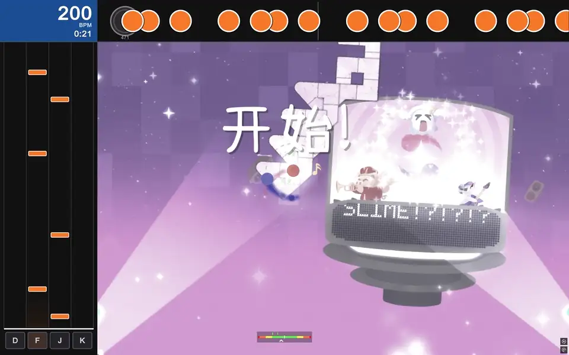
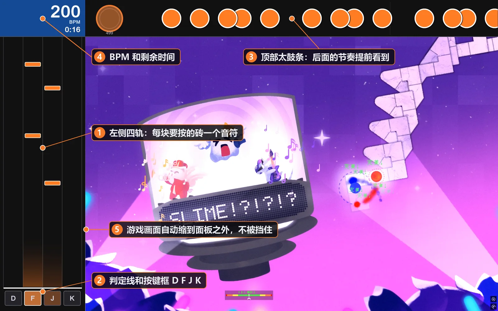
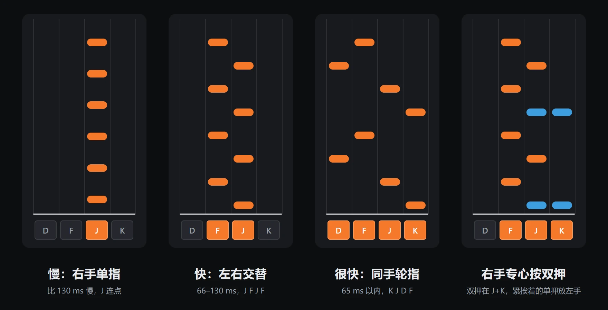
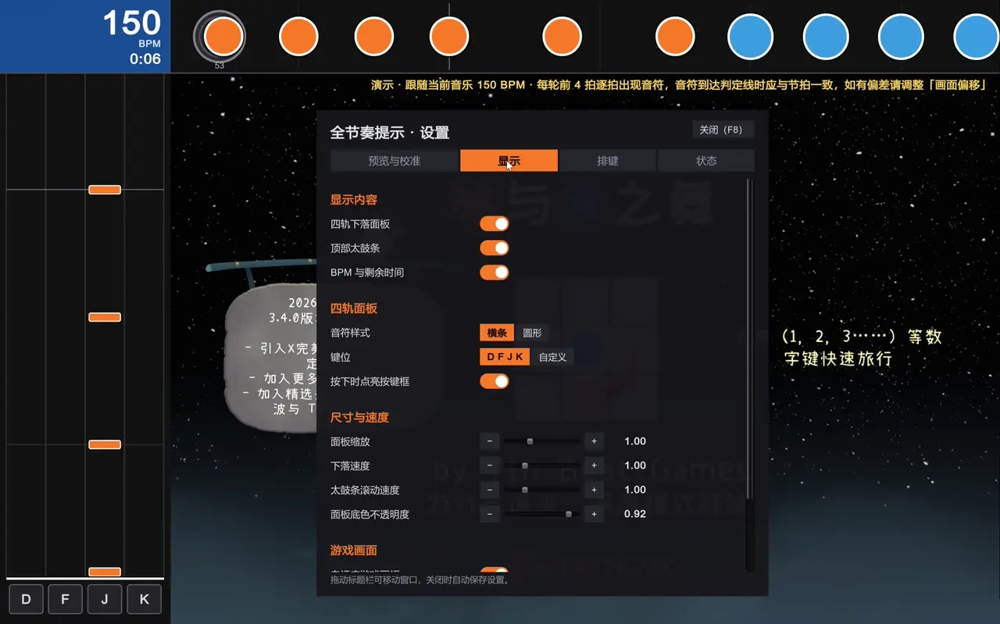
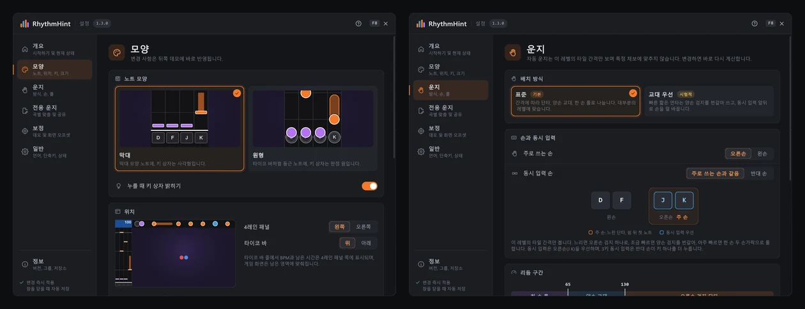

# RhythmHint

**얼불춤에 리듬게임식 안내 패널을 더해 주는 모드**

[简体中文](README.md) | [繁體中文](README.zh-Hant.md) | [English](README.en.md) | 한국어 | [日本語](README.ja.md)

 

얼음과 불의 춤은 아무 키나 눌러도 되지만, 리듬이 꼬이기 시작하면 행성이 도는 것만 봐서는 다음 박자를 읽기가 어렵습니다.

그래서 이 모드를 만들었습니다. 레벨의 타일을 떨어지는 노트로 바꿔서, 리듬게임처럼 다음에 무엇을 눌러야 할지 미리 볼 수 있게 해 줍니다. 보여 주기만 할 뿐 판정에는 손대지 않으니 기록은 원래 방식 그대로입니다.

## 화면 구성

- **왼쪽 4개 레인**: 눌러야 하는 타일마다 노트가 하나씩 나옵니다. 주황색은 단일 노트, 파란색은 2키 동시, 보라색은 3키·4키 동시이고, 홀드에는 꼬리가 붙습니다. 설정에서 막대를 태고 바처럼 동그란 노트로 바꿀 수 있습니다
- **아래쪽 키 상자**: D F J K를 누르면 불이 들어옵니다
- **위쪽 태고 바**: 앞으로 나올 리듬을 길게 미리 볼 수 있습니다
- **왼쪽 위**: 현재 BPM과 남은 시간
- **게임 화면 자동 맞춤**: 게임 화면과 UI 글자(콤보, 판정, 일시정지 메뉴)가 패널 바깥으로 줄어들어 가려지지 않습니다 (설정에서 끌 수 있습니다)

레벨이 시작되면 패널이 들어오고 끝나면 나갑니다. Esc로 일시정지할 때도 접혀서 일시정지 메뉴를 가리지 않고, 죽으면 화면이 멈췄다가 다시 시작하면 이어집니다. 공식 레벨, 커스텀 레벨, 에디터 테스트 플레이와 자동 플레이 모두 지원합니다.

## 키 배치 방식

외부 채보는 읽지 않습니다. 각 레벨은 자기 타일 사이의 간격만 보고, 대부분의 얼불춤 플레이어 습관에 맞춰 배치합니다.

- 느릴 때(165 ms보다 길 때): **오른손 검지 J로 연타**
- 조금 빠를 때: **J F, 양손 검지를 번갈아**
- 아주 빠를 때(82 ms 이내): 한 손의 두 손가락을 번갈아, **K J D F**
- 쉬었다가 다시 시작할 때는 항상 **오른손**부터
- 2키 동시는 되도록 **오른손 J K**에 두고, 바로 옆의 단일 노트는 **왼손**에 두어 오른손이 동시 입력에 집중하게 합니다. 양손에 하나씩 나뉜 동시 입력은 나오지 않습니다
- 같은 손에서 검지 다음에 바깥 손가락(F→D, J→K)이 오지 않으며, 롤은 항상 바깥 손가락부터 누릅니다
- 같은 키를 150 ms 안에 두 번 누르게 하지 않습니다

왼손잡이는 설정에서 주로 쓰는 손을 왼손으로 바꾸면 배치 전체가 좌우 반전됩니다. 왼손 F가 중심이 되고, 2키 동시는 D F, 롤은 D F K J가 됩니다.

단일 노트는 한 손, 동시 입력은 다른 손으로 치는 게 편하다면 "동시 입력 손"을 "반대 손"으로 바꾸세요. 예를 들어 오른손 J가 중심인 채로 2키 동시는 왼손 D F에 두고, 동시 입력 바로 옆의 단일 노트는 오른손으로 옮깁니다.

3키·4키 동시도 인식합니다(보라색). 3키 동시는 동시 입력 손이 키 두 개를, 반대 손 검지가 키 하나를 누르고, 4키 동시는 네 키를 모두 누릅니다.
어떤 타일을 동시에 누르는지는 경로가 얼마나 꺾이는지로 판단합니다. 제작자가 한데 모아 그린 타일(회전 각도가 아주 작은 타일)은 동시 입력이 되고, 각도는 평범한데 BPM만 아주 높은 빠른 연타는 더 이상 2키 동시로 잘못 묶이지 않습니다.

손에 맞지 않으면 기준 간격과 롤은 모두 설정에서 조절할 수 있습니다.

## 설정

게임 안에서 **F8**을 누르세요.

레벨 밖에서 설정을 열면 메뉴 음악에 맞춘 데모가 옆에서 재생되어, 무엇을 바꾸든 바로 확인할 수 있습니다. 노트와 음악이 맞지 않으면 여기서 "화면 오프셋"을 노트가 정확히 박자에 닿을 때까지 조정하세요.

창은 끌어서 옮길 수 있고 닫을 때 자동으로 저장되며, 창 안을 클릭해도 게임에 입력되지 않습니다.

인터페이스 언어는 상태 페이지에서 바꿀 수 있습니다: 简体中文, 繁體中文, English, 한국어, 日本語. 기본값은 게임 언어를 따르며, 번역이 없는 언어는 영어로 표시됩니다.

## 키 배치 검토하기

Mod 설정의 상태 페이지에서 현재 레벨의 키 배치를 내보낸 뒤, 로컬 [RhythmHint Studio](tools/review-editor/README.md)에서 JSON을 여세요. 노트를 다른 레인으로 끌어 배치를 바꾸고, 검토 파일을 내보내 변경 내용을 저장할 수 있습니다. `.adofai` 파일로 오프라인 미리보기도 가능하며 음악은 별도로 선택합니다. 정확한 검토에는 게임 안에서 내보낸 데이터를 사용하세요.

기본값은 기존 시간 리셋 방식입니다. 운지 설정에서 검토 내용을 바탕으로 한 선택형 배치 방식을 시험하고 언제든 원래 방식으로 돌아갈 수 있습니다. 자세한 내용은 [검토 안내](docs/排键审核指南.md)와 [선택형 규칙 설명](docs/审核偏好实验规则.md)(중국어)을 참고하세요.

## 설치

1. [Unity Mod Manager](https://www.nexusmods.com/site/mods/21)를 설치합니다 (0.27 이상, DoorstopProxy 방식)
2. [Releases](https://github.com/xiaoming6680/ADOFAI-RhythmHint/releases)에서 `RhythmHint-<버전>.zip`을 받아, UMM 설치 프로그램의 Mods 탭에서 **Install Mod**를 눌러 선택합니다 (압축 파일을 창에 끌어다 놓아도 됩니다)
   - 직접 압축을 풀어 `RhythmHint` 폴더를 `게임 폴더\Mods\`에 넣어도 됩니다
3. 게임에서 `Ctrl+F10`을 눌러 활성화되어 있는지 확인합니다

나중에 업데이트할 때는 새 `RhythmHint-<버전>.zip`만 설치하면 되고, UMM은 다시 설치하지 않아도 됩니다. 새 버전이 나오면 F8 설정 창의 제목 표시줄에 알림이 뜨고, UMM 설치 프로그램의 Mods 탭에서 이 모드를 오른쪽 클릭해 **Update**를 고르면 바로 업데이트됩니다(1.1.0 이하 버전에는 아직 없는 기능입니다). 버전별 변경 내용은 [변경 기록](CHANGELOG.en.md)(영어)에 있습니다.

직접 빌드하려면 [개발 문서](docs/开发说明.md)(중국어)를 참고하세요.

## 문제 해결

- **안내가 나오지 않음**: F8 → 상태 페이지에 이유가 나옵니다. UMM 로그 `Managed\UnityModManager\Log.txt`에도 남습니다
- **D F J K를 쓰지 않음**: 표시 페이지에서 "사용자 지정"을 누르고 화면 키보드에서 자신의 네 키를 고르세요 (Shift, 스페이스, 방향키도 됩니다)
- **기록에 영향이 있나요?** 없습니다. 판정은 전혀 건드리지 않습니다

## 감사의 말

- 아이디어와 기술은 Bilibili 크리에이터 **Winkle雪线**의 영상 [《【冰与火之舞·全节奏提示】CE-TX Dramatic Entrance!》](https://www.bilibili.com/video/BV17Agv6sEug)을 참고했습니다. 감사합니다!
- [Unity Mod Manager](https://www.nexusmods.com/site/mods/21) 기반
- 스크린샷은 공식 레벨 CI-X "REINCARNA✝ION!! ~아이돌 졸업~" (7th Beat Games), 곡 *REINCARNA✝ION!! Idol Graduation* by Turbo ft. Moon Jelly

## 라이선스

코드는 [MIT](LICENSE)로 공개합니다. 스크린샷 속 레벨 화면과 음악의 저작권은 원작자에게 있습니다.
