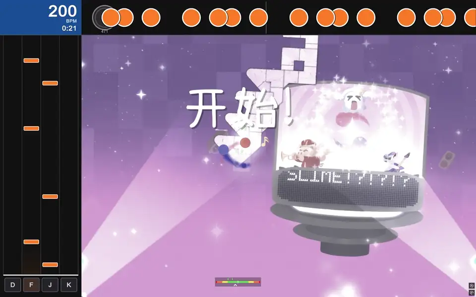
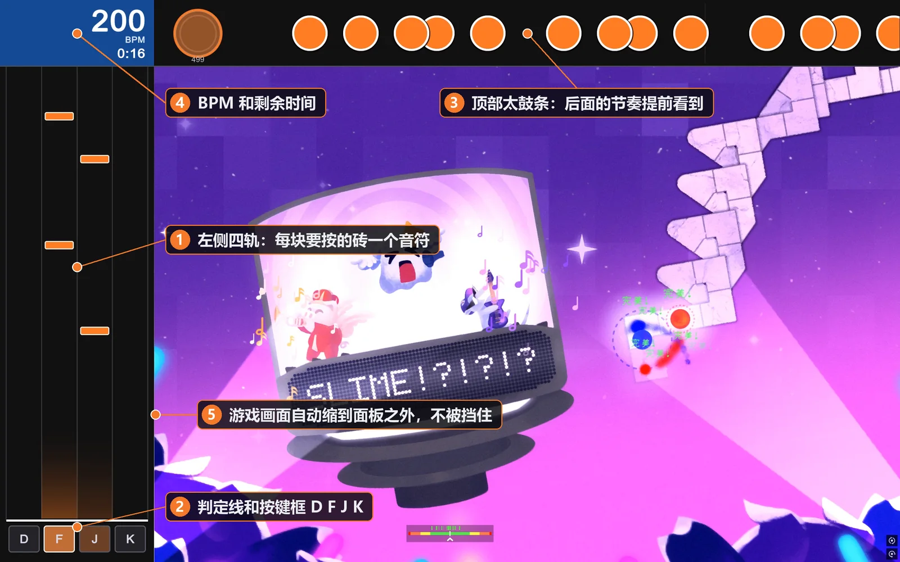
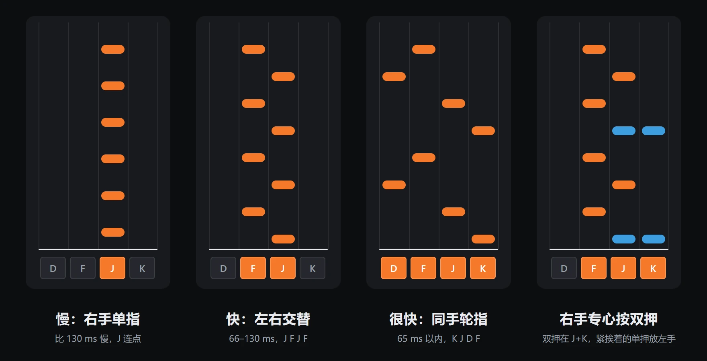
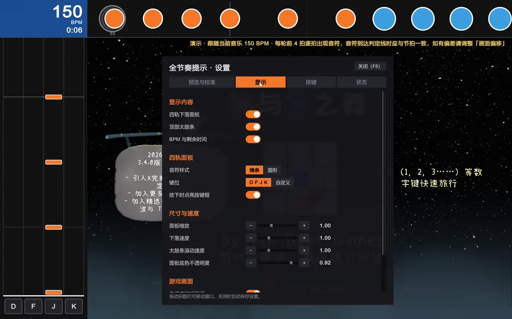
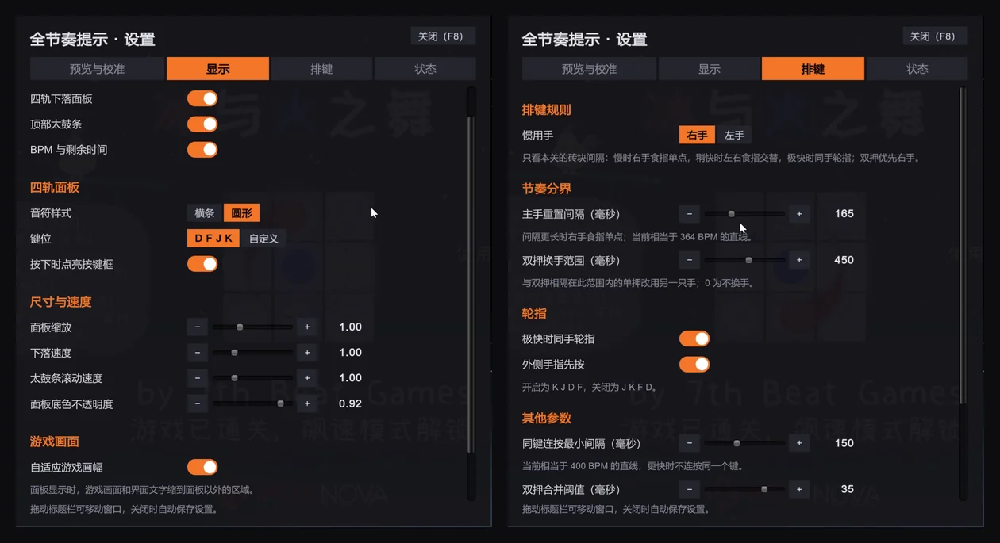

# 全节奏提示 RhythmHint

**给冰与火之舞加一块音游式的提示面板**

简体中文 | [繁體中文](README.zh-Hant.md) | [English](README.en.md) | [한국어](README.ko.md) | [日本語](README.ja.md)

 

冰与火之舞随便按哪个键都算，可节奏一乱，光盯着星球转圈根本读不过来。

所以我做了这个 Mod：把每一关的砖块变成下落式音符，像打音游一样提前看到接下来要按什么。它只负责「看」，不碰判定，成绩还是原来那套算法。

## 长什么样

- **左边四条轨道**：每块要按的砖对应一个音符。橙色单押，蓝色双押，紫色三押、四押，长按带尾巴；设置里能把横条换成和太鼓条一样的圆球
- **底下的按键框**：按 D F J K 会亮
- **顶上的太鼓条**：后面一长串节奏都能提前瞄到
- **左上角**：当前 BPM 和剩余时间
- **自适应游戏画幅**：游戏画面和界面文字（连击数、判定、暂停菜单）自动缩到面板以外，不会被挡住（不喜欢可以在设置里关）

开局面板滑进来，打完滑出去；按 Esc 暂停时也会收起，不挡暂停菜单；死了画面会停住，重开就接着走。官方关、自制关、编辑器里试玩和自动播放都能用。

## 键是怎么排的

不读任何外部谱面，每关只看它自己砖块之间的间隔，按大多数冰与火玩家的习惯排：

- 慢的（两下隔 165 ms 以上）：**右手食指 J 连点**
- 快一些：**J F 左右食指轮流**
- 很快（82 ms 以内）：同一只手两根手指轮流，**K J D F**
- 停下来之后总是从**右手**开始
- 双押尽量放在**右手 J K**，紧挨着双押的单押放**左手**，右手专心按双押；不会出现一左一右的双押
- 同一只手不会先食指再外侧手指（F→D、J→K），轮指都是外侧手指先落
- 同一个键不会在 150 ms 内连按两次

左撇子可以在设置里把惯用手换成左手，整套排法左右镜像：左手 F 为主，双押优先 D F，轮指变成 D F K J。

习惯单押用一只手、双押用另一只手的，可以把「多押用手」换成「另一只手」：比如右手 J 为主、双押放左手 D F，紧挨着双押的单押就改用右手。

三押、四押也认得出来（紫色）：三押是按双押的那只手按两个键、另一只手食指补一个，四押四个键全按。
哪些砖算同时按，看的是谱面上转了多大的角：谱师画成一团（转角很小）的就是多押；转角正常、只是 BPM 很高的快连打不会再被当成双押。

觉得不顺手，分界线和轮指都能在设置里调。

## 设置

游戏里按 **F8**。

不在关卡里的时候，打开设置会在旁边放一段跟着菜单音乐走的演示，改什么都能马上看到效果。觉得音符和音乐对不上，就在这里调「画面偏移」，调到音符正好踩在拍子上。

窗口可以拖，关掉自动保存；在窗口里点来点去不会误触游戏。

设置的「状态」页可以换界面语言：简体中文、繁體中文、English、한국어、日本語，默认跟着游戏的语言走，没有翻译的语言显示英文。

## 安装

1. 装好 [Unity Mod Manager](https://www.nexusmods.com/site/mods/21)（0.27 以上，选 DoorstopProxy 方式）
2. 去 [Releases](https://github.com/xiaoming6680/ADOFAI-RhythmHint/releases) 下载 `RhythmHint-版本号.zip`，在 UMM 安装器的 Mods 页点 **Install Mod** 选它（或直接把压缩包拖进窗口）
   - 也可以手动解压，把里面的 `RhythmHint` 文件夹放进 `游戏目录\Mods\`
3. 进游戏按 `Ctrl+F10` 确认它已启用

国内下载慢的话，[夸克网盘](https://pan.quark.cn/s/6ef42ac0c8dd?pwd=uxha)里有 UMM 和最新版 Mod，Mod 交流 Q 群 1136407588 的群文件里也有。以后更新只要换新的 `RhythmHint-版本号.zip`，UMM 不用重装。有新版本时 F8 设置窗口的标题栏会提示，在 UMM 安装器的 Mods 页右键本 Mod 选 **Update** 就能一键更新（1.1.0 及更早的版本还没有这个功能）。

想自己编译看[开发说明](docs/开发说明.md)。

## 遇到问题

- **提示没出来**：F8 →「状态」页会写原因，UMM 日志 `Managed\UnityModManager\Log.txt` 里也有
- **不用 D F J K**：设置「显示」页点「自定义」，在屏幕键盘上点出你自己的四个键（Shift、空格、方向键也行）
- **会不会影响成绩**：不会，判定完全没动
- **反馈、交流**：QQ 群 1136407588（ADOFAI-RhythmHint），群文件里也有最新版

## 致谢

- 灵感和技术参考来自 B 站 UP 主 **Winkle雪线** 的[《【冰与火之舞·全节奏提示】CE-TX Dramatic Entrance!》](https://www.bilibili.com/video/BV17Agv6sEug)，谢谢！
- 基于 [Unity Mod Manager](https://www.nexusmods.com/site/mods/21)
- 截图来自官方关卡 CI-X《REINCARNA✝ION!! ～偶像毕业～》（7th Beat Games），乐曲 *REINCARNA✝ION!! Idol Graduation* by Turbo ft. Moon Jelly

## 许可证

代码用 [MIT](LICENSE) 开源。截图里的关卡画面和音乐版权归原作者。
