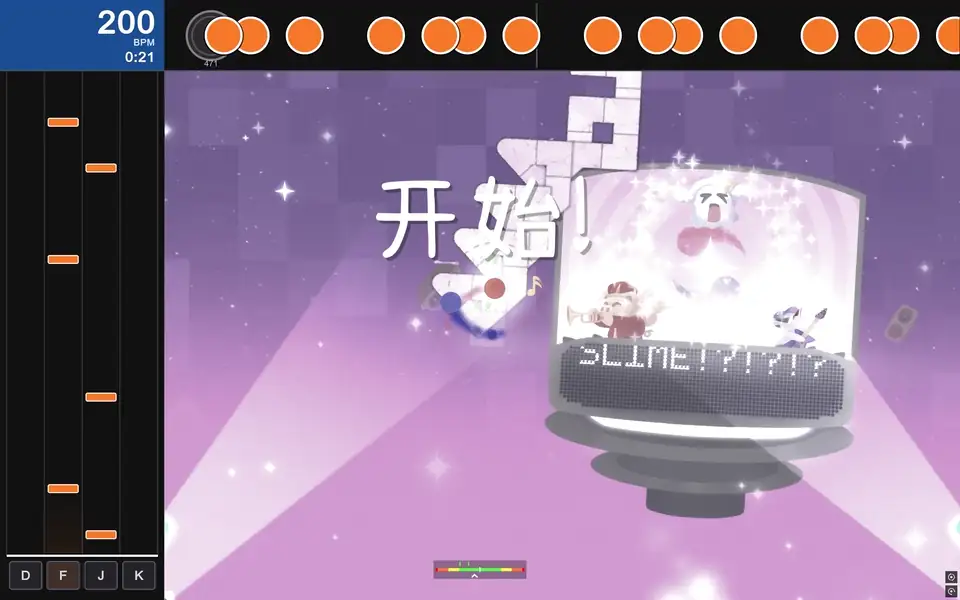
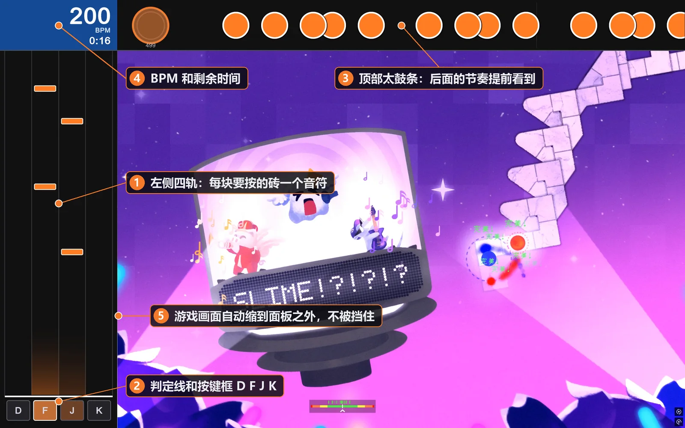
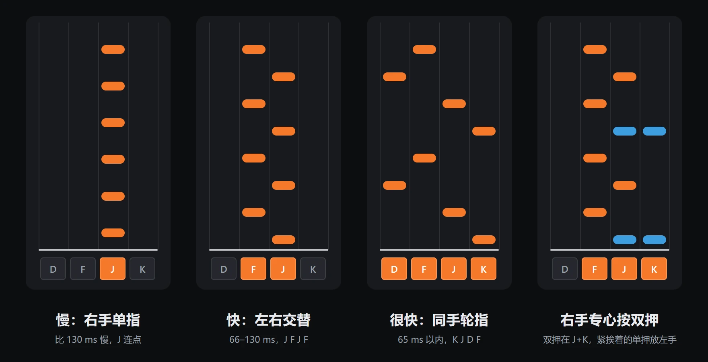
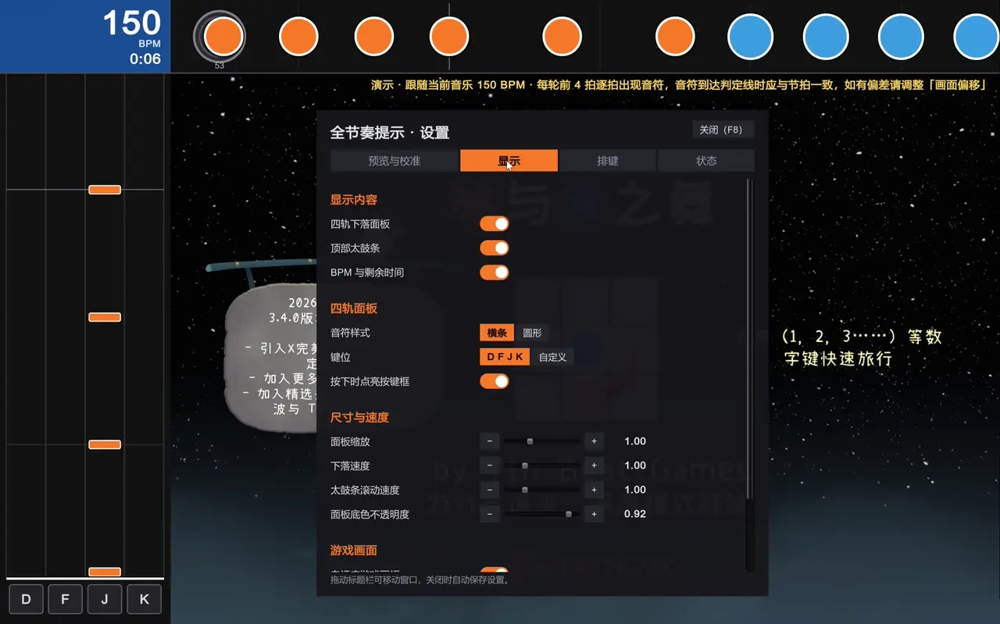
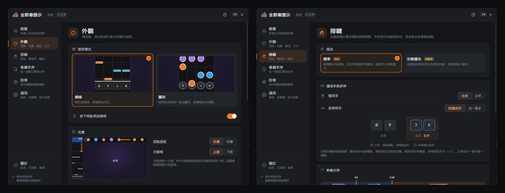

# 全節奏提示 RhythmHint

**給冰與火之舞加一塊音遊式的提示面板**

[简体中文](README.md) | 繁體中文 | [English](README.en.md) | [한국어](README.ko.md) | [日本語](README.ja.md)

 

冰與火之舞隨便按哪個鍵都算，可是節奏一亂，光盯著星球轉圈根本讀不過來。

所以我做了這個 Mod：把每一關的磚塊變成下落式音符，像打音遊一樣提前看到接下來要按什麼。它只負責「看」，不碰判定，成績還是原本那套算法。

## 長什麼樣

- **左邊四條軌道**：每塊要按的磚對應一個音符。橘色單押，藍色雙押，紫色三押、四押，長按帶尾巴；設定裡能把橫條換成和太鼓條一樣的圓球
- **下面的按鍵框**：按 D F J K 會亮
- **上面的太鼓條**：後面一長串節奏都能提前瞄到
- **左上角**：目前 BPM 和剩餘時間
- **自適應遊戲畫幅**：遊戲畫面和介面文字（連擊數、判定、暫停選單）自動縮到面板以外，不會被擋住（不喜歡可以在設定裡關）

開局面板滑進來，打完滑出去；按 Esc 暫停時也會收起，不擋暫停選單；死了畫面會停住，重開就接著走。官方關、自製關、編輯器裡試玩和自動播放都能用。

## 鍵是怎麼排的

不讀任何外部譜面，每關只看它自己磚塊之間的間隔，照大多數冰與火玩家的習慣排：

- 慢的（兩下隔 165 ms 以上）：**右手食指 J 連點**
- 快一些：**J F 左右食指輪流**
- 很快（82 ms 以內）：同一隻手兩根手指輪流，**K J D F**
- 停下來之後總是從**右手**開始
- 雙押盡量放在**右手 J K**，緊挨著雙押的單押放**左手**，右手專心按雙押；不會出現一左一右的雙押
- 同一隻手不會先食指再外側手指（F→D、J→K），輪指都是外側手指先落
- 同一個鍵不會在 150 ms 內連按兩次

左撇子可以在設定裡把慣用手換成左手，整套排法左右鏡像：左手 F 為主，雙押優先 D F，輪指變成 D F K J。

習慣單押用一隻手、雙押用另一隻手的，可以把「多押用手」換成「另一隻手」：比如右手 J 為主、雙押放左手 D F，緊挨著雙押的單押就改用右手。

三押、四押也認得出來（紫色）：三押是按雙押的那隻手按兩個鍵、另一隻手食指補一個，四押四個鍵全按。
哪些磚算同時按，看的是譜面上轉了多大的角：譜師畫成一團（轉角很小）的就是多押；轉角正常、只是 BPM 很高的快連打不會再被當成雙押。

覺得不順手，分界線和輪指都能在設定裡調。

## 設定

遊戲裡按 **F8**。

不在關卡裡的時候，打開設定會在旁邊放一段跟著選單音樂走的演示，改什麼都能馬上看到效果。覺得音符和音樂對不上，就在這裡調「畫面偏移」，調到音符正好踩在拍子上。

視窗可以拖，關掉自動儲存；在視窗裡點來點去不會誤觸遊戲。

設定的「狀態」頁可以換介面語言：简体中文、繁體中文、English、한국어、日本語，預設跟著遊戲的語言走，沒有翻譯的語言顯示英文。

## 安裝

1. 裝好 [Unity Mod Manager](https://www.nexusmods.com/site/mods/21)（0.27 以上，選 DoorstopProxy 方式）
2. 到 [Releases](https://github.com/xiaoming6680/ADOFAI-RhythmHint/releases) 下載 `RhythmHint-版本號.zip`，在 UMM 安裝器的 Mods 頁點 **Install Mod** 選它（或直接把壓縮檔拖進視窗）
   - 也可以手動解壓縮，把裡面的 `RhythmHint` 資料夾放進 `遊戲目錄\Mods\`
3. 進遊戲按 `Ctrl+F10` 確認它已啟用

下載慢的話，[夸克網盤](https://pan.quark.cn/s/6ef42ac0c8dd?pwd=uxha)裡有 UMM 和最新版 Mod，Mod 交流 Q 群 1136407588 的群檔案裡也有。以後更新只要換新的 `RhythmHint-版本號.zip`，UMM 不用重裝。有新版本時 F8 設定視窗的標題列會提示，在 UMM 安裝器的 Mods 頁右鍵本 Mod 選 **Update** 就能一鍵更新（1.1.0 及更早的版本還沒有這個功能）。

想自己編譯看[開發說明](docs/开发说明.md)（簡體中文）。

## 遇到問題

- **提示沒出來**：F8 →「狀態」頁會寫原因，UMM 記錄檔 `Managed\UnityModManager\Log.txt` 裡也有
- **不用 D F J K**：設定「顯示」頁點「自訂」，在螢幕鍵盤上點出你自己的四個鍵（Shift、空白鍵、方向鍵也行）
- **會不會影響成績**：不會，判定完全沒動
- **回饋、交流**：QQ 群 1136407588（ADOFAI-RhythmHint），群檔案裡也有最新版

## 致謝

- 靈感和技術參考來自 B 站 UP 主 **Winkle雪线** 的[《【冰与火之舞·全节奏提示】CE-TX Dramatic Entrance!》](https://www.bilibili.com/video/BV17Agv6sEug)，謝謝！
- 基於 [Unity Mod Manager](https://www.nexusmods.com/site/mods/21)
- 截圖來自官方關卡 CI-X《REINCARNA✝ION!! ～偶像畢業～》（7th Beat Games），樂曲 *REINCARNA✝ION!! Idol Graduation* by Turbo ft. Moon Jelly

## 授權

程式碼以 [MIT](LICENSE) 開源。截圖裡的關卡畫面和音樂版權歸原作者。
